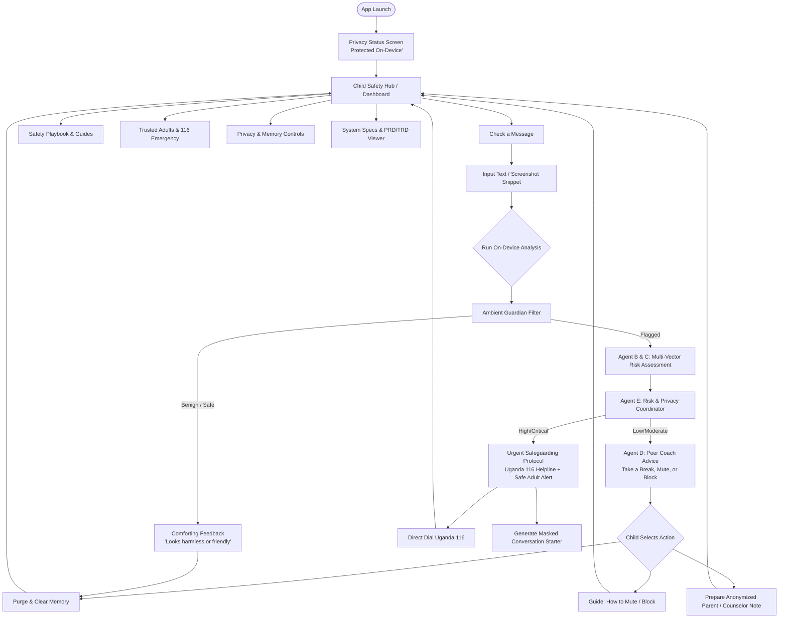
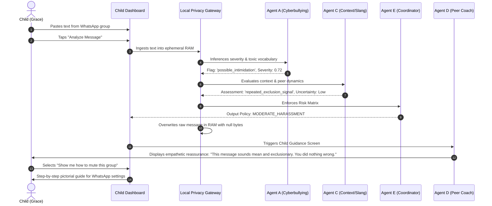
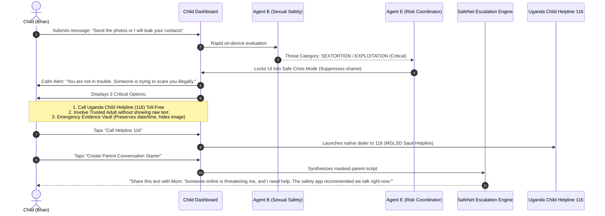

# App Flow and User Journeys

## Project: SafeShield Uganda (ChildSafe AI)
**Interactive Experience Flowcharts, Decision Trees, and Journey Maps**  
*Document Version:* 1.0.0  
*Status:* Approved UX Architecture

---

## 1. High-Level App Flow Architecture

SafeShield is designed with a non-linear, reassuring navigation structure. Unlike disciplinary apps, every transition minimizes anxiety, maximizes child autonomy, and provides immediate emergency exists.

---

## 2. Detailed User Journey 1: Checking Ambiguous Classmate Banter

**Actor:** Grace (13 years old, Primary school pupil)  
**Scenario:** A peer writes: *"You're useless, don't show your face at basketball practice today or else."*

---

## 3. Detailed User Journey 2: Critical Extortion & Sextortion Crisis

**Actor:** Brian (15 years old)  
**Scenario:** An online stranger demands intimate photographs and threatens public humiliation.

---

## 4. Screen-by-Screen Navigation Hierarchy

| Screen ID | Screen Title | Primary User Actions | Accessible Sub-Actions |
| :--- | :--- | :--- | :--- |
| **SCR-01** | **Safety Dashboard** | Check a message; view safety status; emergency dial 116 | Dark mode toggle; site search; cookie preferences; quick safety tips |
| **SCR-02** | **Message Checker** | Paste text; select platform; trigger multi-agent pipeline | Clear input; load demo scenario; toggle privacy details |
| **SCR-03** | **Agent Inspection Lab** | Step through Agent A -> B -> C -> D -> E live execution | View JSON output; inspect confidence vectors; verify zero-cloud payload |
| **SCR-04** | **Peer Coach Guidance** | Select empathetic action; review step-by-step advice | Copy safe response; launch mute guide; request adult support |
| **SCR-05** | **Uganda 116 Gateway** | Dial 116 toll-free; learn what helpline counselors do | View MGLSD details; read Children Act rights; offline emergency steps |
| **SCR-06** | **Trusted Contact Relay** | Generate masked SMS for guardian; configure trusted contact | Test notification simulator; lock settings with PIN |
| **SCR-07** | **Privacy & Cryptography** | Immediate RAM wipe; inspect Keystore status; view local DB audit | Verify zero-knowledge guarantee; clear all offline caches |
| **SCR-08** | **Interactive TRD/PRD Docs** | Search technical docs; print documentation; copy specs | Filter sections; expand architecture diagrams |

---

## 5. Error Handling & Edge Cases

1. **Empty / Non-Text Input:** UI triggers gentle inline error banner (`"Please paste a message or select a test scenario"`).
2. **Offline Mode:** App displays green `"100% Offline Active"` indicator; telephone dialer relies on GSM voice call which requires no internet data.
3. **App Minimization / Backgrounding:** Sensitive guidance automatically hides and scrubs temporary text fields to prevent shoulder-surfing.
4. **Child Panic Button:** Floating persistent button instantly switches the screen to a discreet educational/calculator screen or returns home safely.
