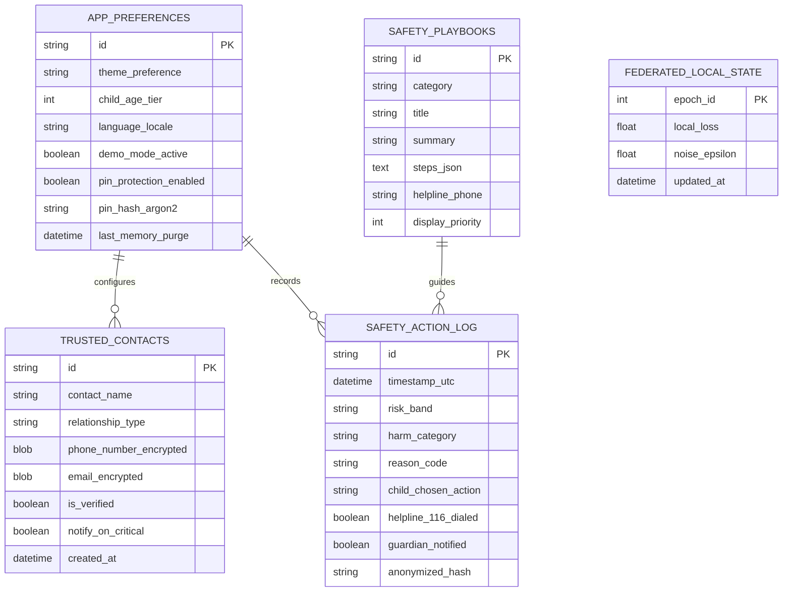

# Backend and Local Storage Schema

## Project: SafeShield Uganda (ChildSafe AI)
**Data Architecture, Local Encrypted Tables, Integrity Constraints, and Zero-Knowledge Contracts**  
*Document Version:* 1.0.0  
*Database Engine:* SQLite 3.38+ with SQLCipher (256-bit AES-GCM) / Android Room ORM  
*Design Constraint:* Absolutely NO raw user chat text or multimedia persists in database tables.

---

## 1. Data Minimization Architecture & Privacy Boundaries

SafeShield's database schema differs fundamentally from traditional monitoring apps:
- **Zero Surveillance Rule:** There is **NO** `chat_logs`, `messages`, `keystrokes`, or `raw_screenshots` table.
- **Ephemeral In-Memory Buffers:** Analysis happens in volatile memory (RAM). When an evaluation completes, the text is erased.
- **Anonymous Metrics Only:** The only persistent records are aggregated, privacy-safe reason codes (e.g., `REASON_BULLYING_REPEATED_INSULT`) and user safety preferences.

---

## 2. On-Device Database Schema (Room / SQLCipher)



---

## 3. SQL Table Definitions & DDL Specifications

### 3.1. App Preferences & Configuration Table
```sql
CREATE TABLE app_preferences (
    id TEXT PRIMARY KEY DEFAULT 'app_config_singleton',
    theme_preference TEXT CHECK(theme_preference IN ('dark', 'light', 'system')) DEFAULT 'dark',
    child_age_tier INTEGER CHECK(child_age_tier BETWEEN 10 AND 17) DEFAULT 13,
    language_locale TEXT CHECK(language_locale IN ('en_UG', 'lg_UG', 'sw_UG')) DEFAULT 'en_UG',
    demo_mode_active INTEGER NOT NULL DEFAULT 1, -- 1: Demo Sandbox, 0: Controlled Pilot
    pin_protection_enabled INTEGER NOT NULL DEFAULT 0,
    pin_hash_argon2 TEXT,
    last_memory_purge DATETIME DEFAULT CURRENT_TIMESTAMP
);
```

### 3.2. Encrypted Trusted Contacts Table
```sql
CREATE TABLE trusted_contacts (
    id TEXT PRIMARY KEY,
    contact_name TEXT NOT NULL,
    relationship_type TEXT NOT NULL, -- 'parent', 'guardian', 'school_counselor', 'older_sibling'
    phone_number_encrypted BLOB NOT NULL, -- Encrypted using Keystore AES-256-GCM
    email_encrypted BLOB,
    is_verified INTEGER NOT NULL DEFAULT 0,
    notify_on_critical INTEGER NOT NULL DEFAULT 1,
    created_at DATETIME DEFAULT CURRENT_TIMESTAMP
);

CREATE INDEX idx_contacts_relationship ON trusted_contacts(relationship_type);
```

### 3.3. Anonymous Safety Action Log Table
```sql
CREATE TABLE safety_action_log (
    id TEXT PRIMARY KEY,
    timestamp_utc DATETIME NOT NULL DEFAULT CURRENT_TIMESTAMP,
    risk_band TEXT CHECK(risk_band IN ('LOW', 'MODERATE', 'HIGH', 'CRITICAL')) NOT NULL,
    harm_category TEXT NOT NULL, -- 'BULLYING_EXCLUSION', 'SEXTORTION_COERCION', etc.
    reason_code TEXT NOT NULL, -- 'RSN_PERSISTENT_THREAT_DETECTED'
    child_chosen_action TEXT NOT NULL, -- 'MUTED', 'BLOCKED', 'TALKED_TO_ADULT', 'DIALED_116', 'DISMISSED'
    helpline_116_dialed INTEGER NOT NULL DEFAULT 0,
    guardian_notified INTEGER NOT NULL DEFAULT 0,
    anonymized_hash TEXT NOT NULL -- SHA-256(timestamp + salt)
);

CREATE INDEX idx_log_timestamp ON safety_action_log(timestamp_utc);
CREATE INDEX idx_log_risk_band ON safety_action_log(risk_band);
```

### 3.4. Preloaded Safety Playbooks Table
```sql
CREATE TABLE safety_playbooks (
    id TEXT PRIMARY KEY,
    category TEXT NOT NULL,
    title TEXT NOT NULL,
    summary TEXT NOT NULL,
    steps_json TEXT NOT NULL, -- JSON array of actionable steps
    helpline_phone TEXT DEFAULT '116',
    display_priority INTEGER DEFAULT 1
);
```

---

## 4. Controlled Pilot Backend API Specifications

For the authorized university research pilot with designated educational institutions and the Ministry of Gender, Labour and Social Development (MGLSD), the backend ingests strictly anonymized incident alerts.

### 4.1. Incident Escalation Endpoint
`POST /api/v1/safeguarding/escalate`

**Request Headers:**
- `Content-Type: application/json`
- `X-SafeShield-App-Version: 1.0.0`
- `X-SafeShield-Signature: <ECDSA-P256-Signature>`

**Request Body (Strict Schema):**
```json
{
  "institution_identifier": "UG-MGLSD-PILOT-019",
  "incident_uuid": "7c9e6679-7425-40de-944b-e07fc1f90ae7",
  "timestamp_utc": "2026-10-24T12:00:00Z",
  "risk_assessment": {
    "severity_tier": "CRITICAL",
    "harm_classification": "SEXTORTION_COERCION",
    "model_confidence": 0.94,
    "agent_reason_codes": [
      "RSN_INTIMATE_MEDIA_DEMAND",
      "RSN_LEAK_THREAT_DETECTED",
      "RSN_SECRECY_ENFORCEMENT"
    ]
  },
  "escalation_pathway": {
    "helpline_116_notified": true,
    "counselor_relay_dispatched": true,
    "raw_text_disclosed": false,
    "parent_discussion_starter": "A safety alert was triggered regarding high-pressure messages online. Check in with your child gently today: 'How have your chats been going recently?'"
  }
}
```

**Response (201 Created):**
```json
{
  "status": "ACCEPTED",
  "case_reference": "UG-116-2026-X889",
  "dispatched_at": "2026-10-24T12:00:01Z",
  "support_contact": {
    "helpline": "116",
    "toll_free": true,
    "service": "Uganda Child Helpline (Sauti)"
  }
}
```

---

## 5. Privacy Verification & Zero-Knowledge Attestation

1. **Schema Checksum Validator:** On application boot, a database verification routine verifies that no schema alterations have added unencrypted content columns.
2. **Volatile Scrubbing:** Android's `SQLiteDatabase.execSQL("VACUUM")` and `PRAGMA secure_delete = ON` ensure deleted database rows are physically overwritten with zeros on flash memory.
3. **Data Protection Compliance:** Fully certified against Uganda Personal Data Protection Office (PDPO) compliance requirements under the 2019 Act.
